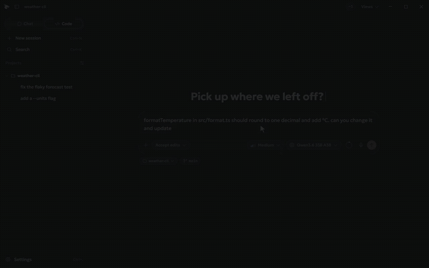

<div align="center">


# Draggy

A local AI assistant and coding agent for Windows, macOS and Linux. Free, open source, no account.

[](https://draggy.org)
[](https://github.com/Lucki74/draggy/releases)
[](https://github.com/Lucki74/draggy/releases/latest)
[](LICENSE)



<sub>Code mode on a sample project. Model waits are sped up 6 times.</sub>

</div>

> [!WARNING]
> Only install Draggy from this repo, its [releases page](https://github.com/Lucki74/draggy/releases) or [draggy.org](https://draggy.org).
> Builds aren't code signed yet, so there's no way to check a copy from anywhere else.

Draggy is a desktop app that chats, browses the web and works in your project folders, with open models running on your own computer. Despite the name it's not slow (the core is written in Rust).

The models run locally through an embedded `llama.cpp` engine, with GGUF weights from Hugging Face. There's no account and no telemetry. Draggy only goes online for things you ask for or turn on:

- model and engine downloads
- update checks
- ad-block lists
- the price refresh behind the cost counters (you can turn this one off in Settings)

Updates are always on in packaged builds. It's the same Tauri 2 app on all three systems.

If you've used LM Studio, Jan or Ollama, the big difference is the coding agent. It reads, edits and runs commands in a project folder, shows every change as a diff you can undo, and works under one of five permission modes. It can also run big Mixture-of-Experts models that don't fit in memory, straight from your drive.

The full docs are at [docs.draggy.org](https://docs.draggy.org), in English, French, Spanish and Russian. Start with [Installation](https://docs.draggy.org/installation), or [Building and architecture](https://docs.draggy.org/development) if you want to work on the code.

## What it can do

- Local GGUF models via llama.cpp
- GPU acceleration with CUDA, Metal, Vulkan or ROCm
- A coding agent with undoable diffs
- A sandboxed agent environment
- A folder and bundled Python for every chat
- Separate chat and code workspaces
- Deep research
- Document generation
- MCP servers and 572 built-in skills
- Large MoE models from disk
- Voice chat, with a local or cloud voice
- Image generation, local or through a cloud provider
- Pictures in answers, opened in a viewer
- Videos in chat, read frame by frame by a vision model
- A local API that speaks OpenAI, Anthropic and Ollama (see [API.md](API.md))
- External runtimes and cloud APIs
- Cost counters for cloud usage, with local turns priced at OpenRouter rates

## Installing

You can get installers for Windows (`.exe`), macOS (`.zip`, one app for Intel and Apple silicon) and Linux (`.deb`, `.rpm`, AppImage) from [draggy.org](https://draggy.org) or the [Releases page](https://github.com/Lucki74/draggy/releases/latest). The first time you open it, Draggy suggests a model that fits your hardware and downloads it for you. System requirements and setup per platform are in [Installation](https://docs.draggy.org/installation).

Image generation is optional. You install it from Settings, under Models. The engine is its own download, 17 to 900 MB depending on the build. Stable Diffusion 1.5 needs about 2 GB of video memory and Z-Image Turbo about 6 GB. With less, the weights stay in system memory. You can also pick a cloud image model from a provider you connected, and that one needs no engine at all.

Large models live in Settings, under Models, in the Large models panel. Draggy downloads colibri when you need it, plus a small private Python runtime on Windows. When a model runs below 3 tokens per second, Draggy switches to slow mode: fewer tool rounds per turn, thinking off unless you turn it on, and a notification when a long answer is ready.

If Draggy is useful to you, starring the repo helps other people find it.

## Building from source

[](https://github.com/Lucki74/draggy/actions/workflows/ci.yml)


[](https://m8ven.ai/mcp/lucki74-draggy-1jbywd?s=readme)

On Windows, macOS or Linux:

```bash
cd app
npm install
npm run tauri:dev
```

That starts Vite and the Tauri window with hot reload. The first run needs the Rust toolchain, the system libraries for your platform and the pinned `node` sidecar, see [CONTRIBUTING.md](CONTRIBUTING.md).

The repo layout is in [Building and architecture](https://docs.draggy.org/development). If you want to help, read [CONTRIBUTING.md](CONTRIBUTING.md) first, and [RELEASING.md](RELEASING.md) explains how builds get out.

## Logs

Draggy writes normal events to `app.log` in its data folder and detailed traces to `debug.log`. Prompts and other text are hashed in both, so your chats don't end up in a log. Where to find them on each system is in [Troubleshooting](https://docs.draggy.org/troubleshooting).

## Rough edges

- Answers are only as good as the model you pick, its size and its quantization.
- Speed depends on how much CPU and GPU memory bandwidth you have.
- Large models depend on your drive. A hard disk or a USB drive is usually too slow to be useful.

## Websites

- [websites/www](websites/www): the source of [draggy.org](https://draggy.org)
- [websites/docs](websites/docs): the source of [docs.draggy.org](https://docs.draggy.org)

Report a problem with the website or the docs in its own repository.

## License

Draggy uses the [Apache License 2.0](LICENSE). You can use it, change it, share it and ship it, commercial projects included, as long as you keep the [NOTICE](NOTICE) file.

### Trademarks

The license covers the code, not the Draggy name and logo. Provider logos in the app belong to their owners.
